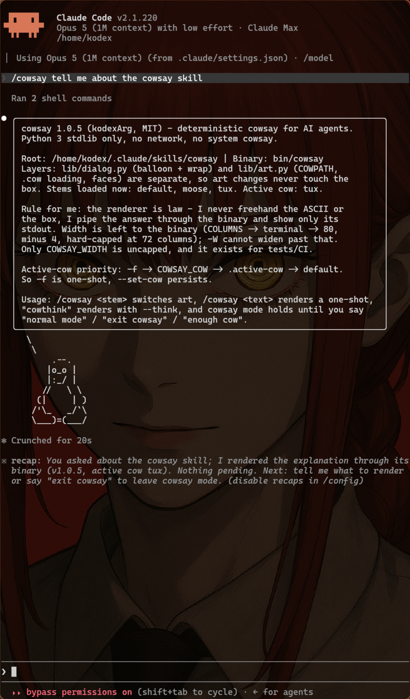

# cowsay 🐮



A cow that talks in your agent's terminal. **One Python 3 stdlib file** — no
network, no pip, no system `cowsay`. **MIT**, by [kodexArg](https://kodexarg.com).

```bash
npx skills add kodexArg/cowsay
```

```text
╭─ ✔ ÉXITO ─────────────────────────────────╮
│ Shipped the fix 🚀 https://example.com    │
╰───────────────────────────────────────────╯
        \   ^__^
         \  (^^)\_______
            (__)\       )\/\
                ||----w |
                ||     ||
```

## Talk to it

| You say | It does |
|---|---|
| `/cowsay hello world` | one-shot render |
| `/cowsay tux` | swap the animal for the session |
| `/cowsay` | cow mode — every reply comes out of the cow |
| "think it" | thought bubbles |

## CLI

```bash
bin/cowsay "moo"                        # args or stdin
bin/cowsay --ok   "deployed"            # ╭─ ✔ ÉXITO ─╮  eyes ^^
bin/cowsay --fail "build broke"         # ╭─ ✘ FALLO ─╮  eyes xx
bin/cowsay --warn -t "heads up" "..."   # custom title
bin/cowsay --think -f cat "hmm"         # 💭
bin/cowsay -l                           # default tux moose cat koala
```

- Rounded box, title in the border, mood-aware eyes.
- Real display width: emoji, CJK and accents keep the box straight.
- URLs and paths are never split.
- Width follows the terminal, capped at 72. `COWSAY_WIDTH` pins it, `COWSAY_COW` picks the animal.

**The renderer is law**: agents never freehand the box or the animal — they pipe
through `bin/cowsay` and show only stdout.

```text
skills/cowsay/
  SKILL.md          agent instructions
  bin/cowsay        the whole thing (~120 lines)
  tests/            python3 skills/cowsay/tests/test_cowsay.py
```

🙏 Original cowsay by Tony Monroe — <https://github.com/cowsay-org/cowsay>
